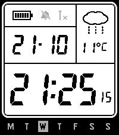

# pebcio

A Casio-style LCD watchface for the Pebble Time 2 (emery, 200×228), built with Alloy (Moddable JavaScript).



## Features

- Large 7-segment time, with seconds that can stay on, stay off, or show for 30 seconds after a wrist flick, tap or button press
- Date in DD-MM or MM-DD, with a weekday strip that starts on Monday or Sunday
- Current temperature (°C or °F) and a weather icon from [Open-Meteo](https://open-meteo.com/), no API key needed
- Battery, Quiet Time and Bluetooth indicators
- 12 or 24 hour clock
- Settings page in the Pebble app, made with [Clay](https://github.com/pebble/clay)

## Building

You need the Pebble SDK with Alloy support.

```sh
npm install
pebble build
pebble install --emulator emery     # or: pebble install --phone <IP>
```

## Fonts

- **7-Segment** by Jan Bobrowski ([torinak.com](https://torinak.com/font/7-segment)) is used for the time, seconds and date. `Segment7Px*.ttf` are versions snapped to the pixel grid so the digits don't shift by a pixel when they change. To regenerate them, run `tools/make_seg7.sh <python with fontTools>`.
- **DSEG14** and **DSEGWeather** by keshikan ([DSEG](https://github.com/keshikan/DSEG)) are used for the temperature, AM/PM and weather icons.

All of them are under the SIL Open Font License 1.1. See [src/embeddedjs/assets/FONTS.txt](src/embeddedjs/assets/FONTS.txt).

## Credits

Inspired by CORE91 by tc5206.

## License

Copyright (C) 2026 Tobias Pryning. The code is licensed under the [GNU General Public License v3.0 or later](LICENSE). The fonts keep their own SIL Open Font License (see [Fonts](#fonts)).
